# 🏎️ F1 Pit Wall Dashboard


* **Core Language:** 
* **Libraries & Frameworks:**   
* **Engineering Concepts:**  

F1 Pit Wall Dashboard is a data-driven Streamlit application for Formula 1 race analysis, integrating real-world telemetry using FastF1, tyre degradation analysis, and digital communication simulations. 

🔗 **[Live Demo: Play with the Dashboard here](https://f1pitwalldashboard.streamlit.app/)**

**⚠️ Known Limitations**

>F1's live-timing servers block requests from cloud hosting IPs (including Streamlit Community 
Cloud). The live demo ships with a curated set of pre-downloaded sessions (full list [here](docs/pre_downloaded_sessions.md)); 
selecting a session or driver telemetry outside that set will fail to download when running 
in the cloud (it works fine locally).


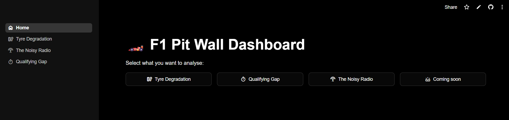
<p align="center"><sub>Fig. 1: A full overview of the F1 Pit Wall Dashboard interface.</sub></p>

---

## 🛠️ Modules Overview

### 1. 🛞 Tyre Degradation (Race & Sprint)
Estimates tyre degradation by analyzing stint pace, correcting raw lap times with a customizable fuel effect coefficient.
* Filters out in-laps, out-laps, anomalous track conditions (Safety Car, VSC) or very slow laps. It only keeps laps where the track is clear.
* Only considers stints with a minimum number of laps.
* Plots a linear regression for each stint to calculate degradation in seconds/lap.
* Slider to choose how much faster the car goes per every lap thanks to fuel consumption.

#### 📐 Formulas 
**Fuel correction:**
To isolate pure tyre drop-off, lap times are adjusted to account for the car getting lighter considering a fuel effect. A standard F1 rule of thumb states that 10 kg of fuel weight costs ~0.3 seconds per lap. 
So, assuming an average fuel consumption of 1.5 - 2.0 kg per lap, the car naturally gains roughly 0.05 to 0.06 seconds per lap purely from weight reduction. 
To neutralize this weight advantage and observe the true tyre performance, you add this time back to the raw lap times:
$$\text{Corrected Time} = \text{Raw Lap Time} + (\text{Fuel Effect} \times \text{Lap Number})$$

#### ⚠️ Known Limitations
* **Starting Fuel Load:** The exact starting fuel weight is kept secret by the teams. The fuel effect is a linear estimation.
* **Traffic & Dirty Air:** The degradation model currently does not account for time lost behind lapped cars or the aerodynamic penalty of dirty air.
* **Track Evolution:** Rubbering-in effect during the session is not mathematically isolated from tyre degradation.

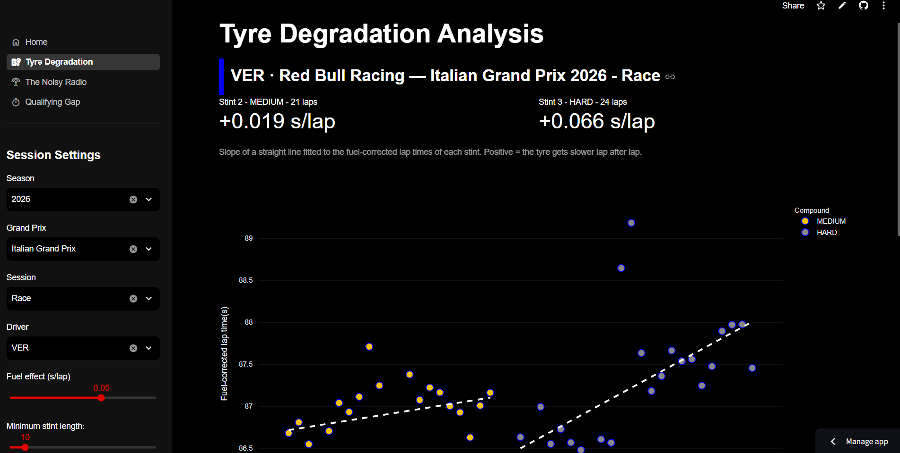
<p align="center"><sub>Fig. 2: Linear regression modeling of tyre drop-off across different stints.</sub></p>

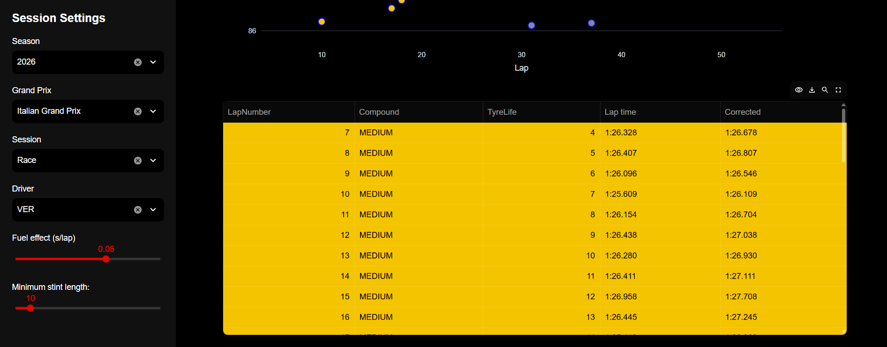
<p align="center"><sub>Fig. 3: Lap Time Table with real lap time, corrected time, tyre life and used compounds.</sub></p>

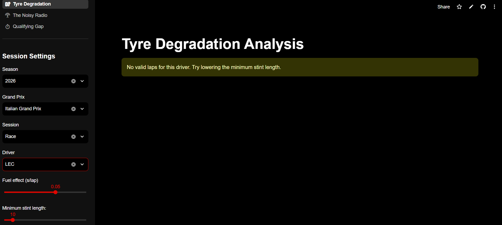
<p align="center"><sub>Fig. 4: Filtering process removing in-laps, out-laps, and SC periods to isolate valid racing conditions. Example with a crash in lap 2.</sub></p>
  
### 2. ⏱️ Qualifying Gap
An interactive horizontal bar chart that visualizes the qualifying pace. 
* Automatically extracts the fastest valid lap for each driver.
* Calculates dynamic time deltas (gap to pole, gap to the preceding driver, and gap to the following driver).
* Styled with official F1 team colors for immediate readability.

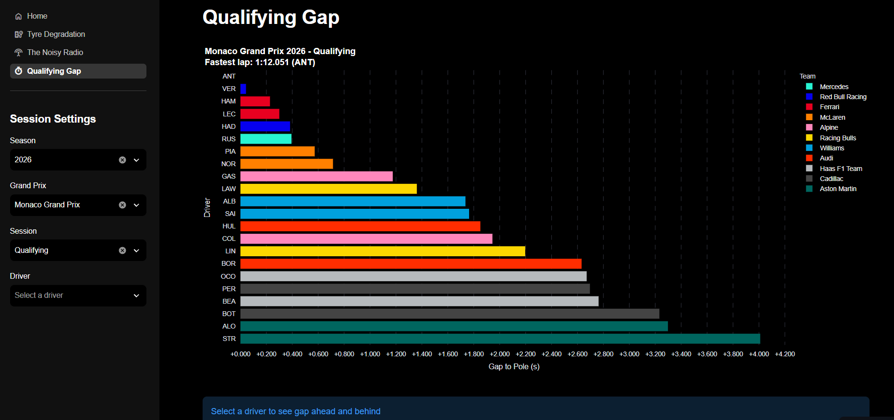
<p align="center"><sub>Fig. 5: Horizontal bar chart displaying qualifying gaps relative to the pole sitter.</sub></p>

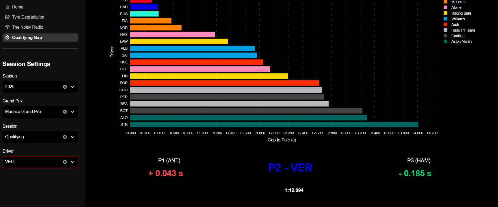
<p align="center"><sub>Fig. 6: Dynamic time deltas showing the exact gap to the preceding and following drivers.</sub></p>

### 3. 📡 The Noisy Radio (Digital Communication System)
A simulation of how F1 car telemetry travels from the car to the pit wall, applying concepts from telecommunications engineering.
* Takes a real, high-frequency telemetry signal (speed).
* Applies ideal sampling and uniform quantization.
* Simulates an AWGN (Additive White Gaussian Noise) non-distorting channel mapping bits into an M-PAM constellation.
* Reconstructs the signal to observe the final MSE and Bit Error Rate (BER).
* It shows lecture notes.

#### 📐 Formulas
* The continuous speed signal is quantized into $L = 2^b$ levels.
* The theoretical Mean Squared Error (MSE) for the uniform quantizer is: 
$$\text{MSE} = \frac{\Delta^2}{12}$$
Where $\Delta$ is the quantization step.
* The bits are then mapped using a Gray-coded M-PAM constellation, and noise is added based on the selected $E_b/N_0$ (dB) ratio. 

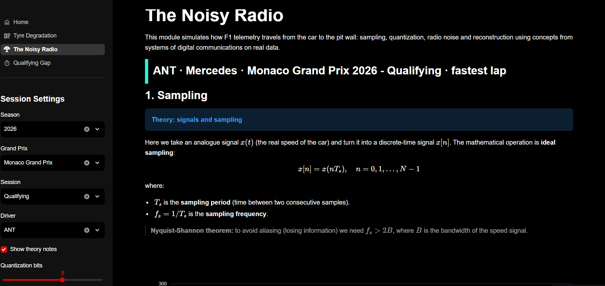
<p align="center"><sub>Fig. 7: Theory notes explaining the ideal sampling of the continuous speed signal.</sub></p>

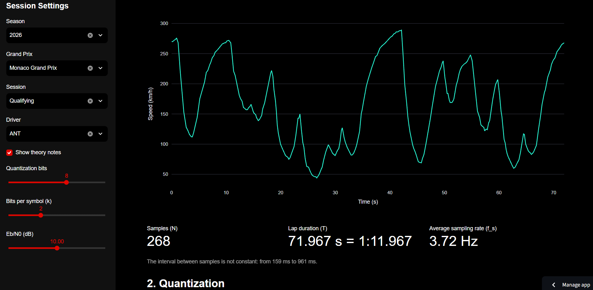
<p align="center"><sub>Fig. 8: Visualization of the sampled telemetry signal.</sub></p>

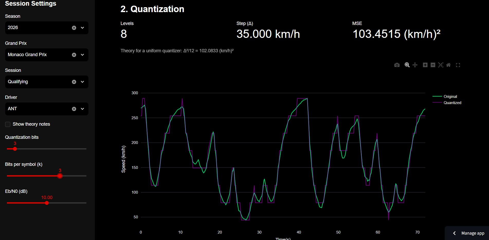
<p align="center"><sub>Fig. 9: Uniform quantization applied to the speed data.</sub></p>

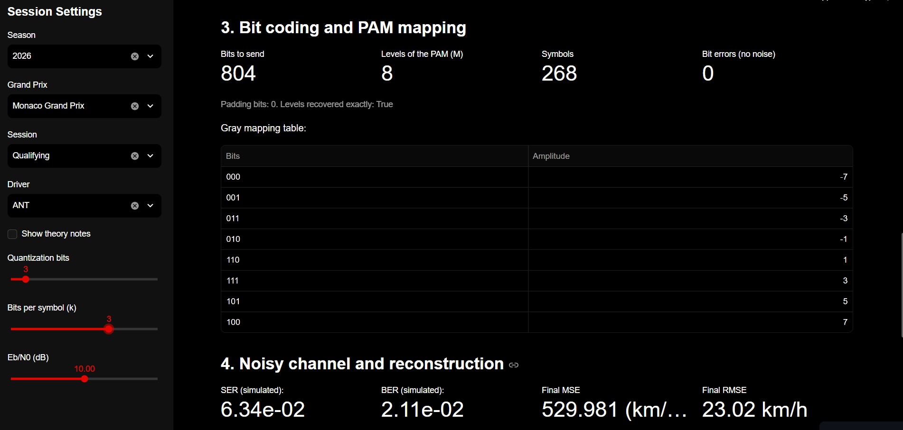
<p align="center"><sub>Fig. 10: Gray-coded mapping table for the M-PAM constellation.</sub></p>

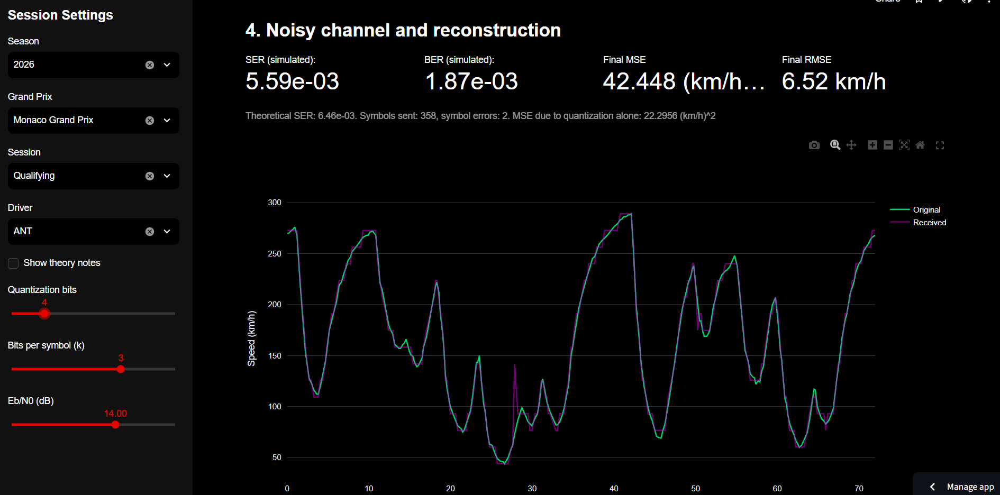
<p align="center"><sub>Fig. 11: Reconstructed signal comparison against the original, highlighting the final MSE and BER after AWGN channel transmission.</sub></p>

### 4. 🎯 Race Strategy Predictor (work in progress)

For five reference circuits (Hungaroring, Spa-Francorchamps, Suzuka, Marina Bay and MadRing), the module estimates race strategies under green-flag conditions, compares two drivers lap by lap and backtests the simulation against the real race. It uses real FastF1 lap data; assumptions that cannot be estimated reliably from public data are exposed as sliders.

- Selects the latest available race and practice sessions for each circuit, states which data are used and warns (with a download button) when a session is missing.
- Estimates green-flag pit stop loss as the median of valid stops, and displays valid and excluded stops.
- **Estimates the pit stop loss under VSC/SC** from the stops that were really made under neutralisation, by comparing the two laps of each stop with the same laps of the drivers who stayed out.
- Estimates tyre degradation by compound, using race data when available and practice data as a fallback.The user chooses which laps are used (all compounds or a single compound) and the statistic (median or mean).
- Generates 1-stop and 2-stop strategies using at least two compounds, and ranks them **with the pace of the selected driver**. For each set of compounds, it keeps the fastest stint split and displays the result with a tyre-coloured bar chart.
- Head-to-head comparison between two drivers, with ranked strategies or **custom strategies** (compound and pit lap chosen by the user, to replay a real race), a **separate pit loss for each driver**, an optional **VSC/SC window with a reduced pit loss**, and the possibility to start the comparison from any lap with a given gap.
- **Backtest:** the simulated gap is overlaid on the real on-track gap, computed from the lap timestamps.

#### 📐 Formulas

**Lap time model** (`a` = tyre age, `n` = lap number, `d` = degradation, `k` = fuel effect):

$$t_{\mathrm{lap}} = t_{\mathrm{base}} + \Delta_{\mathrm{compound}} + d \cdot a - k \cdot n$$

**Driver pace offset.** Each clean lap is compared with the model, and the residuals are summarised per driver (median or mean) and referred to the median driver of the field:

$$r = t_{\mathrm{corrected}} - \left(t_{\mathrm{base}} + \Delta_{\mathrm{compound}} + d \cdot a\right) \qquad o_{\mathrm{driver}} = \mathrm{stat}(r_{\mathrm{driver}}) - \mathrm{median}_{\mathrm{field}}\big(\mathrm{stat}(r)\big)$$

**Pit stop loss under green flag**, calculated for each valid green-flag stop and summarized as the median:

$$L_{\mathrm{pit}} = t_{\mathrm{in-lap}} + t_{\mathrm{out-lap}} - 2\tilde{t}_{\mathrm{clean}}$$

where $\tilde{t}_{\mathrm{clean}}$ is the median clean lap time for that driver.

**Pit stop loss under VSC/SC.** Under neutralisation every lap is slow, so the reference is the set of drivers who stayed out in the same two laps:

$$L_{\mathrm{VSC}} = \left(t_{\mathrm{in}} + t_{\mathrm{out}}\right) - \sum_{n \in \{n_{\mathrm{in}},\, n_{\mathrm{out}}\}} \tilde{t}_{\mathrm{stayed\ out},\, n}$$

Only stops whose in-lap ends under Safety Car, VSC or VSC ending (track status 4, 6 or 7) are counted.

**Gap between drivers**, calculated lap by lap:

$$g_n = g_{n-1} + (t_{\mathrm{rival},n} - t_{\mathrm{driver},n})$$

A positive gap means the selected driver is ahead; a negative gap means the rival is ahead.

In the VSC/SC scenario, a stop whose in-lap falls in the chosen window pays the reduced VSC/SC pit loss instead of the green-flag one. Lap times themselves are not slowed down.

#### 🔬 Backtest: 2026 Spanish GP (MadRing)

**The race.** 57 laps, no red flag. Official result: ANT 1:34:23.754, VER +4.351 s, NOR +5.089 s. A Virtual Safety Car was deployed around lap 14. ANT and VER pitted under the VSC. NOR, the race leader, pitted at lap 15 under green-flag conditions. 

**Pit stop loss.** About 25.9 s under green flag against about 11 s under VSC (median). Most front-runners lost only 5–7 s (VER 5.2 s, RUS 5.5 s, ANT 6.7 s). Stopping under the VSC saved roughly 20 seconds.

**Multi-Driver Backtest Scenarios (Green Flag vs VSC)**
Head-to-head scenarios were simulated across the first three finishers (ANT, VER and NOR). Comparisons start at lap 5 with real track gaps and show how modelling the VSC window changes the result. These are multiple driver-pair scenarios from the same race, not an independent cross-race validation.

| Driver Pair | Scenario | Pace Offset Method | Simulated Final Gap | Real Final Gap | Error |
|---|---|---|---|---|---|
| **NOR vs VER** | Green Flag (no VSC) | All compounds (median) | NOR ahead 19.3 s | VER ahead 0.7 s | ≈ 20.0 s |
| **NOR vs VER** | VSC Modeled | All compounds (median) | VER ahead 3.3 s | VER ahead 0.7 s | ≈ 2.6 s |
| **ANT vs NOR** | Green Flag (no VSC) | All compounds (median) | NOR ahead 14.6 s | ANT ahead 5.1 s | ≈ 19.7 s |
| **ANT vs NOR** | VSC Modeled | All compounds (median) | ANT ahead 5.9 s | ANT ahead 5.1 s | ≈ 0.8 s |
| **ANT vs VER** | VSC Modeled | All compounds (median) | ANT ahead 4.2 s | ANT ahead 4.3 s | ≈ 0.1 s |
| **ANT vs VER** | VSC Modeled | Hard (median) | ANT ahead 15.6 s | ANT ahead 4.3 s | ≈ 11.3 s * |

*\* The Hard (median) method for ANT vs VER exposes the "Dirty Air" effect (see below).*

**Key Insights & The "Dirty Air" Effect**
- **VSC Modeling is Critical:** Comparing the Green Flag and VSC Modeled scenarios demonstrates that applying the correct pit loss during the VSC window (VER ~5.5s, ANT ~7s, NOR ~28.4s) eliminates roughly 20 seconds of error, bringing the simulation within a 0-3 second margin for most setups.
- **The Leclerc Train (Traffic Limitation):** When using the "Hard median" pace offset for ANT vs VER, the model accurately calculates their pure clean-air pace but predicts a 15.6s gap. In reality, from lap 15 to 47, both drivers were stuck in a DRS train behind Leclerc. The divergence between the simulated clean-air line and the flat real-world gap perfectly isolates the time lost to *dirty air*, highlighting the need for a traffic penalty in future developments.

**Visualizing the Impact of VSC**
<p align="center">
  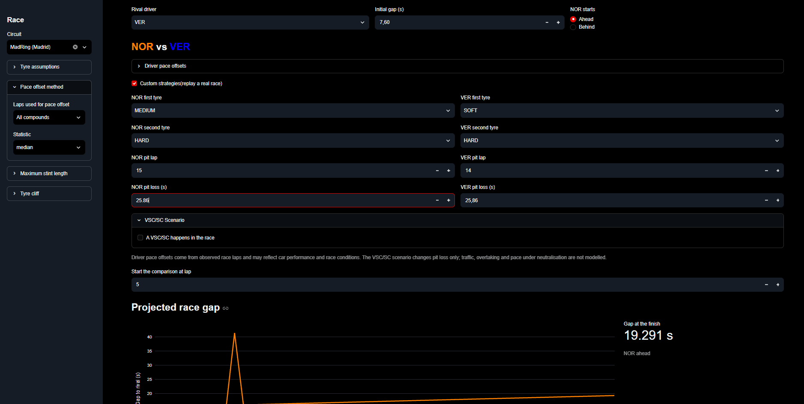
  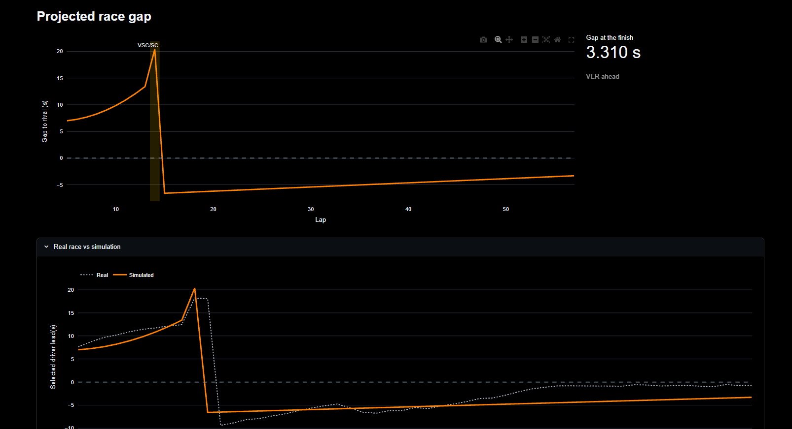
</p>
<p align="center">
  <sub><b>Left:</b> NOR vs VER Green Flag simulation (VSC ignored). The gap swings wildly, resulting in a ~20s error. <b>Right:</b> The same scenario with the VSC window correctly modelled, bringing the final gap prediction within ~2.6s of reality.</sub>
</p>

**Visualizing Accuracy vs Traffic**
<p align="center">
  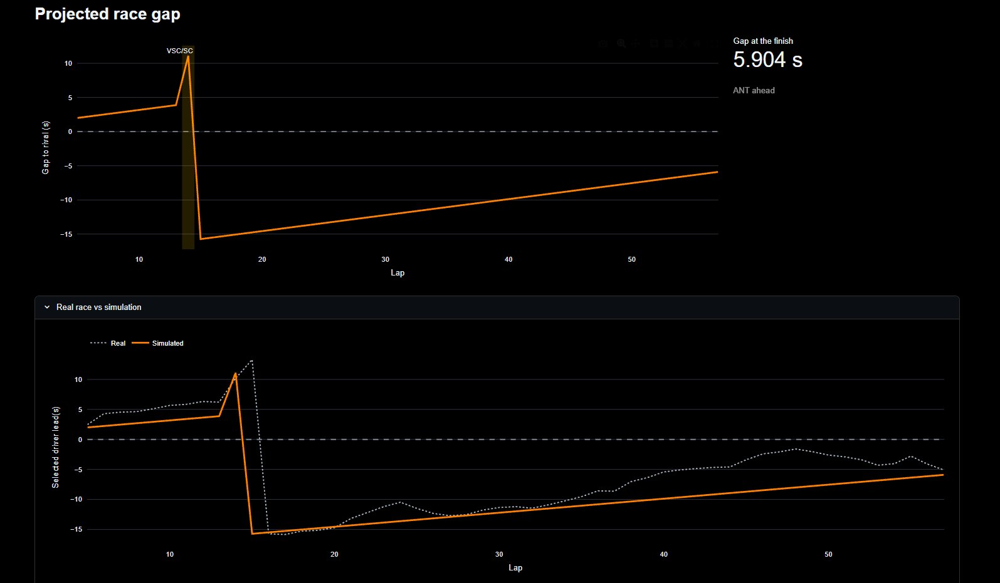
  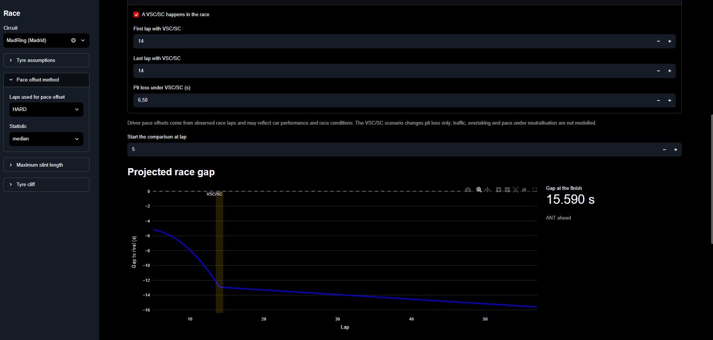
</p>
<p align="center">
  <sub><b>Left:</b> NOR vs ANT (VSC modelled), predicting the final gap with an outstanding 0.8s margin. <b>Right:</b> ANT vs VER highlighting the "Leclerc train" effect, where the simulated clean-air pace (blue line dropping) heavily diverges from the traffic-limited real pace (dotted line).</sub>
</p>

**What the backtest shows**
- With the VSC modelled, the pit stops are reproduced well: the swing caused by VER's stop is +6.8 s simulated against +5.7 s real, and NOR's stop costs about 27.7 s simulated against 27.5 s real.
- The second stint, when both drivers are on Hard tyres, is reproduced almost exactly: NOR gains 9.1 s on VER in the simulation and 8.6 s in the real race (about 0.22 s/lap).
- Most of the remaining error (about 2.7 s of the 4 s) comes from the first stint (laps 5–13). In the real race NOR's gain per lap decreases from 1.1 s to 0.3 s while the model's increases from 0.4 s to 1.5 s: VER was stuck in traffic after giving back a position at lap 4, and the model has no traffic. The soft-tyre degradation (+0.177 s/lap), calibrated on practice sessions, is probably overestimated as well.
- Pace offsets computed on Hard-stint laps with the mean reproduce the real second-stint gaps much better than offsets computed on all laps with the median, which is why the page lets the user choose both.

**Caveat.** The VSC pit loss and NOR's pit loss were measured on this same race, so these results are not an independent cross-race validation. The real gap is the on-track gap from lap timestamps, so time penalties in the official classification are not included. A second race with a neutralisation is needed to test whether the method generalises.

#### 🔬 Case Study: Clean Air Pace vs Track Position (Belgian GP)

**The race.** 44 laps. A high-degradation circuit where track position is heavily compromised by the powerful Overtake mode effect and dirty air in Sector 2. To further validate the model's baseline accuracy and its limitations regarding traffic, head-to-head backtests were run on the 2026 Belgian GP.

**Baseline Accuracy & Tactical Timing (LEC vs VER)**
When evaluating drivers executing 1-stop strategies, the timing of the pit stop is crucial. Verstappen pitted under green-flag conditions before the neutralisations and stayed out during the VSCs on laps 18 and 20. Leclerc, instead, perfectly capitalized on the lap 20 VSC to make his stop, gaining track position over Norris and taking P1. He was ultimately overtaken only by Antonelli. Despite these different tactical scenarios in the real race, replaying their actual pit laps in the baseline simulation predicts a final gap of 1.9 s, accurately reflecting the real-world pace differential between the two.

**The Traffic Penalty (ANT vs LEC)**
The model exposes its clean-air assumption perfectly when analyzing Antonelli's race against Leclerc:
*   **The Simulation:** The model confirms that Antonelli had a significantly stronger raw race pace. In pure clean air, he should have built a massive 19.1 s lead over Leclerc by the finish line.
*   **The Reality:** Antonelli finished only ~1.96 s ahead.
*   **The Root Cause (Telemetry Analysis):** After his pit stop on lap 18, Antonelli emerged in P5. For the next 8 laps (laps 18 to 26), he was stuck in dirty air fighting behind Piastri, Hamilton, and Norris. The model seamlessly accumulated a theoretical clean-air advantage during these laps, while the real Antonelli was bleeding lap time unable to exploit his pace. Once Antonelli cleared the traffic, his real-world gap progression perfectly matches the simulation's slope, allowing him to eventually overtake Leclerc for the win, but with a drastically reduced final margin.

**Conclusion**
This 17-second delta between the theoretical simulation and the official timing is a pure mathematical quantification of the "Traffic Penalty." It proves that while the degradation and pace offsets are mathematically sound in clean air, a race strategy predictor cannot be fully autonomous without a sophisticated traffic and overtaking probability matrix. 

<p align="center">
  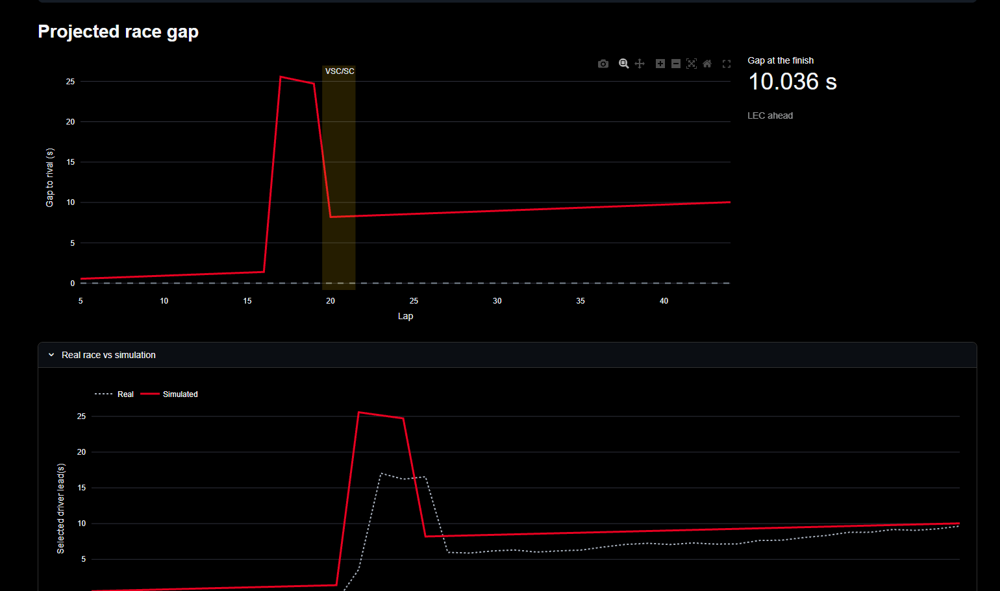
  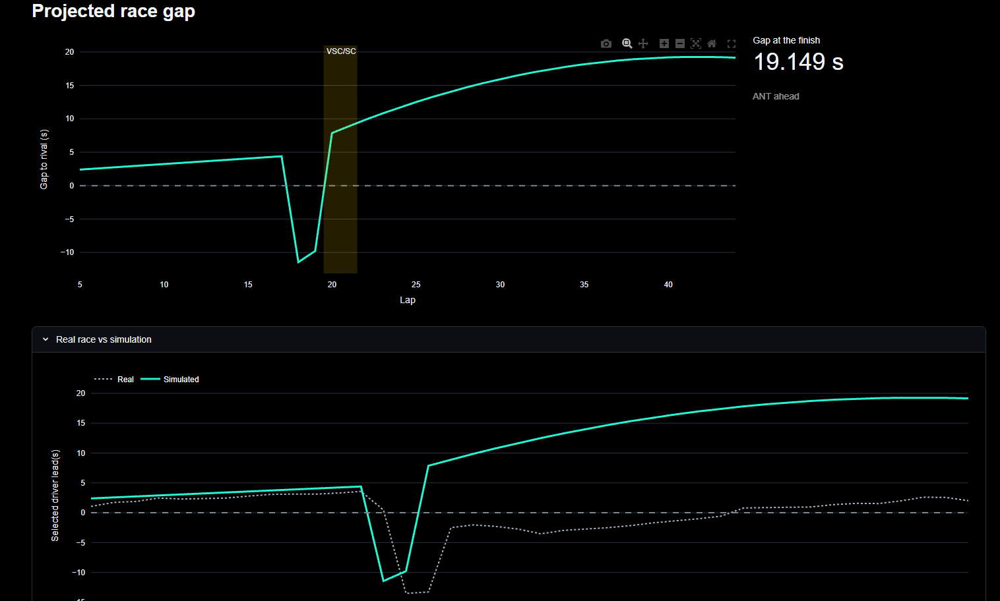
</p>
<p align="center">
  <sub><b>Left:</b> LEC vs VER baseline simulation, predicting the final gap with high accuracy. <b>Right:</b> ANT vs LEC exposing the traffic penalty; the simulation incorrectly projects a 19s lead because it calculates Antonelli's superior raw pace in clean air, not accounting for the 8 laps he spent fighting in the pack.</sub>
</p>

#### ⚠️ Known Limitations

- **Neutralisations are a pit-loss scenario only:** a single VSC/SC window with one pit loss value. Lap times are not slowed down, gaps are not compressed, and Safety Car queues and restarts are not simulated. Red flags and rain are not simulated either.
- **No traffic or overtaking model:** the selected starting position and gap set the initial conditions; the simulation does not model cars physically defending or passing each other. At Madrid this is the main source of the remaining error.
- **Preliminary driver pace offsets:** offsets are estimated from observed race laps after tyre and fuel corrections. They may also reflect car performance, tyre choice, setup, traffic and race conditions, so they are not a pure measure of driver ability. The best laps and statistic to use can change from race to race.
- **Tyre cliff is manual:** the page shows an empirical wear curve, but does not detect the cliff automatically. The user can set what-if cliff parameters with the sidebar sliders.
- **Compound pace offsets** come from public Pirelli/F1 sources and are assumptions, not measurements.
- **Compound labels:** Soft, Medium and Hard refer to the weekend's assigned compounds, which can change between events and seasons.
- **Practice data:** practice laps can be affected by track evolution and different fuel loads, so they are used as a fallback. At Madrid the soft degradation comes from practice and is likely too high.
- **Small samples:** some compounds have few stints, and the pit loss may rely on a limited number of stops.
- **Cross-season data:** when practice and race data come from different seasons, regulation changes may affect comparability.
- **Tyre availability:** The model does not track each driver's available tyre sets or their prior use during the weekend. It may therefore recommend strategies requiring multiple fresh sets of the same compound— for example, two new Soft sets in a two-stop strategy—that may not be available or realistic.

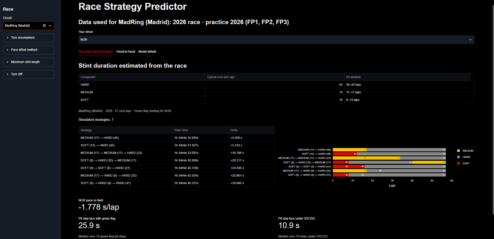
<p align="center"><sub>Fig. 12: MadRing race strategy predictor: ranked strategies for the selected driver and tyre stint chart.</sub></p>

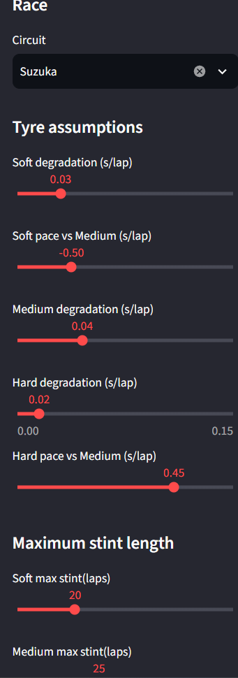
<p align="center"><sub>Fig. 13: Model assumptions in the sidebar: tyre parameters, pace offset method, stint limits and tyre cliff.</sub></p>

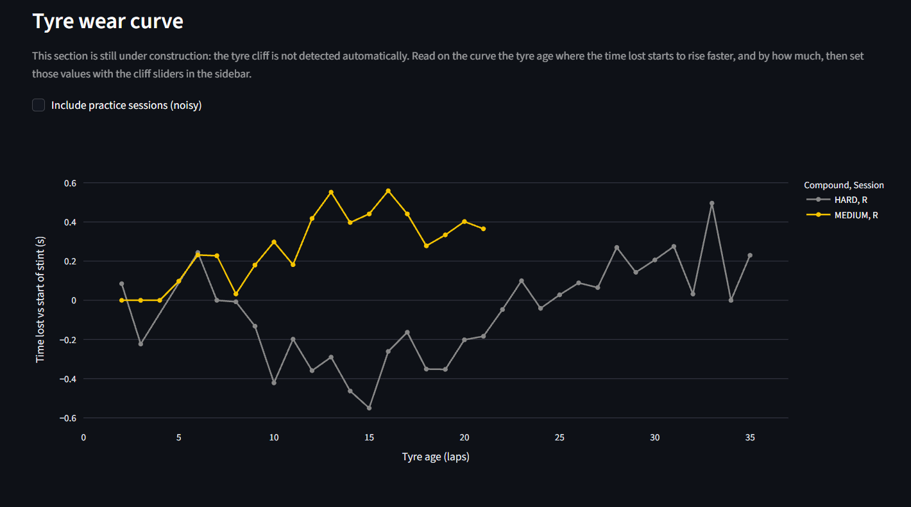
<p align="center"><sub>Fig. 14: Empirical tyre wear curve used to inspect potential cliff behaviour.</sub></p>


---
## 🔮 Future Developments
* **Race Strategy Predictor — next steps:** 
   * a traffic and overtaking model (the main source of the remaining Madrid error);
  * lap-time slowdown and gap compression under VSC/SC, and random neutralisations in a Monte Carlo simulation;
  * backtest on a second race with a neutralisation, with a table of errors for several driver pairs;
  * undercut/overcut analyzer and strategy-vs-strategy matrix.

**Telemetry comparison:** speed, throttle, brake and rpm traces for one driver in a session, and a driver-vs-driver comparison with the time delta; a track map coloured by the faster driver and animated driver positions.

* **Noisy Radio — Level B:** compare bandpass PAM and QAM constellations, plot simulated vs. theoretical SER curves, and derive the required $E_b/N_0$ for a target SER to compare spectral and energy efficiency across modulation schemes.

---

## 💻 Tech Stack
* **Python 3**
* **Streamlit** (UI and Web Deployment)
* **FastF1** (F1 API Data Extraction)
* **Pandas & NumPy** (Data Manipulation & Grouping)
* **SciPy** (Signal Processing & Error Functions)
* **Plotly** (Interactive Data Visualization)

---

## 🚀 How to Run Locally

1. Clone this repository:

   ```bash
   git clone https://github.com/dlcbeatrix/f1_pitwall.git
   cd f1_pitwall
   ```

2. Create and activate a virtual environment:

   ```bash
   python -m venv venv
   venv\Scripts\activate
   ```

3. Install the dependencies:

   ```bash
   pip install -r requirements.txt
   ```

4. Run the Streamlit app:

   ```bash
   streamlit run app.py
   ```

> **Note:** the saved race files now include the lap timestamps and positions needed by the backtest. If you downloaded sessions with an older version, delete the files in `data/laps` so that they are downloaded again.

---

## 👤 Author

Developed by **dlcbeatrix**, Beatrice De Luca, *Computer Engineering Student*. 
